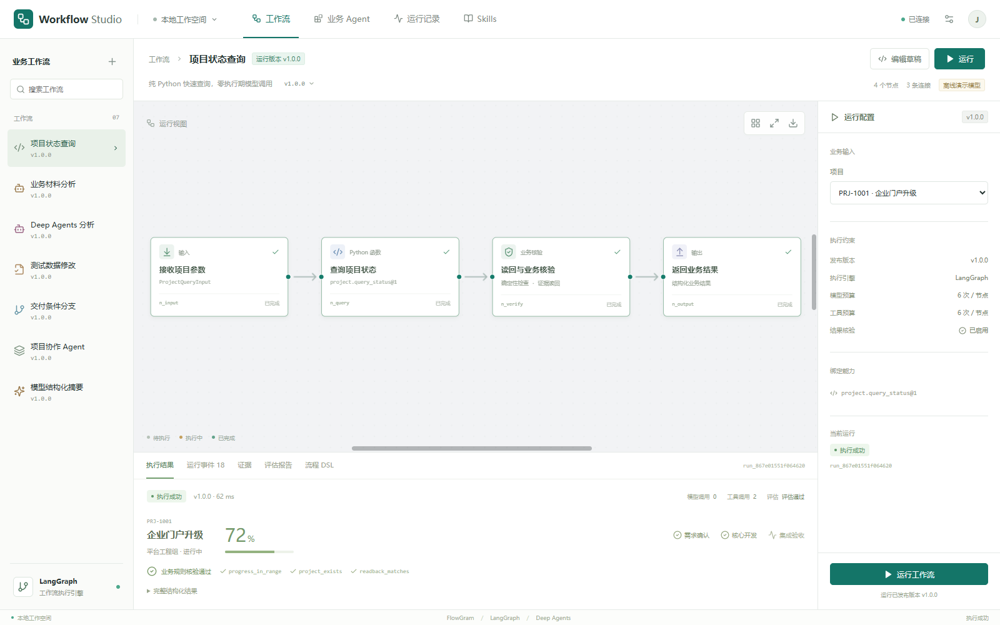

# LangGraph FastFlow

基于 FlowGram、FastAPI 和 LangGraph 的可视化业务 Workflow Demo。
前端支持节点编排、参数配置、版本发布和执行状态回显，后端使用真正的
LangGraph 执行流程，并接入 LangChain 与 Deep Agents 多轮工具调用、Skill 和会话上下文。



## 快速启动

已验证环境：Windows、PowerShell、Python 3.12、Node.js 22 和 uv。

```powershell
git clone https://github.com/JacobHNU/langgraph-fastflow.git
cd langgraph-fastflow/code
.\start.ps1
```

启动脚本自动安装缺失的后端依赖并构建前端，随后打开
<http://127.0.0.1:8000>。接口文档位于 <http://127.0.0.1:8000/docs>。
停止服务使用 `code/stop.ps1`。

默认使用确定性离线演示模型，无需 API Key；流程、Agent 图和工具调用真实执行。
点击界面右上角“工作空间设置”，即可配置模型地址、模型名称、API Key 与生成参数，
测试连接后保存，无需重启。支持 OpenAI、DeepSeek、阿里云百炼、硅基流动、Ollama
及自定义 OpenAI 兼容服务。详细说明见 [项目说明](code/README.md#切换真实模型)。
本地 `.env`、运行数据库、依赖目录及构建产物不提交到仓库。

## 体验示例

新增通用六节点闭环：输入 → HTTP 查询 → 模型摘要 → 核验 → 人工确认 → 输出。当前运行入口为 <http://127.0.0.1:8001/?workflow=customer-order-summary>，独立启动、从空白搭建及真实模型验收见 [M1 实施说明](code/docs/M1_IMPLEMENTATION.md)。

1. 选择“项目状态查询”，点击“运行”：四个 LangGraph 节点查询项目并完成业务核验，执行阶段模型调用为 0。
2. 选择“Deep Agents 分析”，运行后继续追问：体验 Skill、只读工具和会话上下文。
3. 选择“测试数据修改”：确认方案、人工审批、继续执行、写入本地测试项目并读回核验。
4. 复制流程草稿，修改节点及连线，保存、校验、发布后运行自定义流程。

另外包含材料分析、条件分支、固定版本子 Agent 和单次模型摘要示例，共 7 个内置流程。
演示使用本地软件适配器；接入实际业务软件的位置与实现边界见项目说明。

## 项目结构

| 路径 | 内容 |
| --- | --- |
| [设计指南](Agent_Workflow_Architecture_Design_Guide.md) | 整体架构和验收目标 |
| [融合开发指南](Fusion_Workflow_Development_Guide.md) | GraphLoom 功能融合、DSL V2、模块接口、迁移及分阶段验收 |
| [功能对照](code/docs/GRAPHLOOM_COMPARISON.md) | GraphLoom 手册与当前实际实现的逐项比较 |
| [M1 实施说明](code/docs/M1_IMPLEMENTATION.md) | 通用六节点闭环、真实模型示例、启动步骤和本轮测试 |
| [code/README.md](code/README.md) | 完整操作、配置和开发说明 |
| `code/frontend/` | React、TypeScript 和 FlowGram 编排界面 |
| `code/backend/` | DSL 校验、LangGraph、模型执行器、审批、证据和评估 |
| `code/skills/` | 绑定到工作流的业务 Skill |
| [验收记录](code/docs/ACCEPTANCE.md) | 24 项后端测试、7 项浏览器测试及本地实测指标 |
| [开源组件说明](code/THIRD_PARTY_NOTICES.md) | 上游来源、版本和许可证 |

## 上游参考源码

运行依赖由 `uv.lock` 和 `code/frontend/package-lock.json` 锁定。
FlowGram 参考源码不作为嵌套 Git 仓库上传；需要阅读官方示例时，可以自行获取本次参考的固定提交：

```powershell
git clone --filter=blob:none --sparse https://github.com/bytedance/flowgram.ai.git code/vendor/flowgram-reference
git -C code/vendor/flowgram-reference sparse-checkout set apps/demo-free-layout
git -C code/vendor/flowgram-reference checkout 02a01680b53facd3287ba693b588a41527c520a3
```
